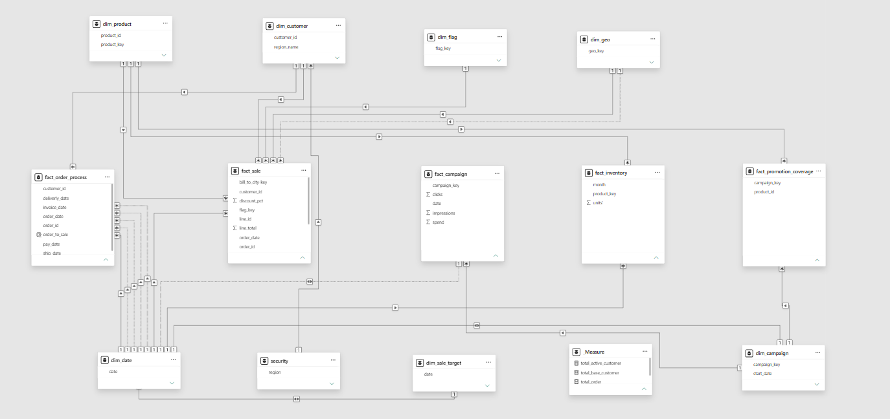

# Large-Scale Retail Data Modeling in Power BI

A comprehensive retail data modeling project that brings sales, orders, inventory, customers, and marketing campaigns into a connected Power BI model.

The focus of this project is organizing source data into meaningful fact and dimension tables, defining relationships, and creating DAX calculations to support business analysis.

## Project Overview

Retail data describes several business processes, each with its own level of detail. Sales lines, order milestones, inventory records, and campaign activity need separate tables while still sharing context such as products, customers, and dates.

This project reorganizes the original source model into a multi-fact model with shared dimensions. The before-and-after screenshots show that transformation.

## Before and After

### Original Data Model

### Cleaned Data Model

## Model Structure

| Business area | Table | Purpose |
| --- | --- | --- |
| Sales | `fact_sale` | Sales line details and amounts |
| Order processing | `fact_order_process` | Order, invoice, payment, shipping, and delivery dates |
| Inventory | `fact_inventory` | Product inventory by month |
| Marketing | `fact_campaign` | Campaign activity, including clicks, impressions, and spend |
| Promotion coverage | `fact_promotion_coverage` | Connections between campaigns and products |

The model also includes:

- **Product and customer dimensions** for grouping and filtering business activity.
- **A date dimension** to support analysis across the different business dates.
- **Geography, campaign, and flag dimensions** to provide additional context.
- **A sales target table** to support target-based analysis.
- **A dedicated measures table** to organize DAX measures.
- **A security table** included in the model structure.

## Modeling Concepts Applied

- Separating business events into fact tables and descriptive information into dimensions.
- Working with multiple fact tables at different levels of detail.
- Using shared dimensions across business processes.
- Configuring relationship cardinality and filter direction.
- Working with active and inactive relationships for different date roles.
- Creating date attributes and DAX calculations.
- Organizing the model to make fields easier to use in reports.

## Repository Files

| File | Description |
| --- | --- |
| [dataset.xlsx](source/dataset.xlsx) | Source Excel dataset |
| [big_data_modeling.pbix](final/big_data_modeling.pbix) | Completed Power BI project |
| [Raw Data.png](images/Raw%20Data.png) | Original model screenshot |
| [Cleaned.png](images/Cleaned.png) | Cleaned model screenshot |

## How to Open the Project

1. Download or clone this repository.
2. Open `final/big_data_modeling.pbix` in Power BI Desktop.
3. To refresh the data, update the Excel source path to your local copy of `source/dataset.xlsx` using **Data source settings** or Power Query.
4. Explore the tables, relationships, and DAX calculations in Model view and the relevant editors.

## Tools Used

**Power BI Desktop · Power Query · DAX · Microsoft Excel**

## Learning Resource

This project was completed while following a [YouTube tutorial](https://www.youtube.com/watch?v=pQSMbRA3O6g). The [referenced tutorial section](https://www.youtube.com/watch?v=pQSMbRA3O6g&t=18272s) starts at **5:04:32**.

This repository presents my implementation and learning work, with credit to the tutorial creator for the learning material.

## Author

**Abdul Moiz Waheed**  
[GitHub Profile](https://github.com/MoizWaheed80)
